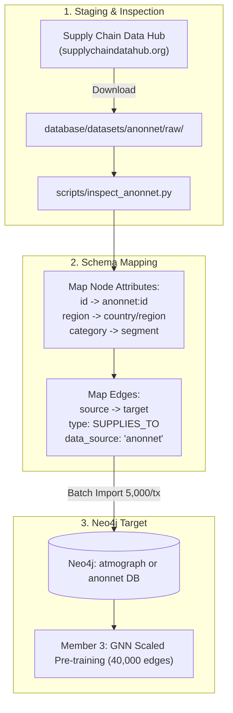

# AnonNet Dataset Inspection & Future Import Plan

## 1. Executive Summary & Source Background

**AnonNet** is an anonymized real-world benchmark dataset representing an extensive industrial manufacturing supply network. It is developed and hosted by the **Supply Chain AI Lab (SCAIL)** at the **University of Cambridge** (led by Liming Xu, Yunbo Long, and Professor Alexandra Brintrup) via the [Supply Chain Data Hub](https://supplychaindatahub.org/).

### Key Benchmark Characteristics
* **Network Scale**: $\sim 7,000+$ nodes and $\sim 40,000+$ directed edges.
* **Entities (Nodes)**: Manufacturing facilities, production plants, supplier organizations, and component clusters.
* **Relationships (Edges)**: Operational dependencies, component flows, and Tier-N supply links.
* **Anonymization Strategy**: Corporate identities, brand names, and proprietary contractual text are scrubbed to preserve commercial confidentiality. Structural network topology, geographic region codes, and product categories are preserved.

---

## 2. Dataset Comparison: Sectivia vs. AnonNet

| Dimension | Sectivia (Primary Baseline) | AnonNet (Future Scale Benchmark) |
| :--- | :--- | :--- |
| **Node Count** | 382 companies | $\approx 7,000+$ entities |
| **Edge Count** | 556 verified contracts | $\approx 40,000+$ supply links |
| **Identifiability** | **Real Identifiers**: Tickers (`AAPL`, `NVDA`), SEC EDGAR filings, press releases. | **Anonymized**: Synthetic IDs (`N1042`, `E8934`), masked corporate names. |
| **Primary Value** | Ground-truth corporate provenance, explainable supply chain paths, real SEC citations for NLP and Frontend UI. | Large-scale graph topology, multi-hop structural depth for GNN benchmark pre-training. |
| **Disruption Labels** | None (pure empirical topology). | None (structural network data). |

---

## 3. Critical Invariant: Strict Isolation (Do Not Merge)

> [!WARNING]
> **DO NOT MERGE ANONNET INTO SECTIVIA**:
> AnonNet entities must **never** be co-mingled or merged with Sectivia companies in the same graph namespace. 
> 
> Merging them would:
> 1. Corrupt the SEC EDGAR audit trail of Sectivia with anonymized dummy IDs.
> 2. Break Member 2's NLP entity resolution (news models cannot resolve anonymized IDs).
> 3. Create confusing hybrid paths in Member 4's Frontend dashboard between real companies and anonymous entities.

### Isolation Strategy
If AnonNet is ingested into AtmoGraph in a future milestone:
1. **Namespace Isolation**:
   - Sectivia IDs: `sectivia:<id>` (e.g. `sectivia:aapl`)
   - AnonNet IDs: `anonnet:<id>` (e.g. `anonnet:node_1042`)
2. **Provenance Partitioning**:
   - Every node and edge must carry `data_source: 'anonnet'`.
3. **Database Partitioning Option**:
   - Alternatively, store AnonNet in a dedicated Neo4j database (`CREATE DATABASE anonnet;`) specifically used by Member 3 for GNN pre-training.

---

## 4. Future Ingestion Architecture

---

## 5. Phased Implementation Roadmap

### Phase 1: Acquisition & Verification
- Retrieve the official Cambridge SCAIL AnonNet distribution files from `supplychaindatahub.org`.
- Place raw files into `database/datasets/anonnet/raw/` (`nodes.csv`, `edges.csv`).
- Create `database/datasets/anonnet/source_info.md` detailing license, version, and citations.

### Phase 2: Inspection Script (`inspect_anonnet.py`)
- Author `database/scripts/inspect_anonnet.py` to audit:
  - Exact column schemas.
  - Node ID uniqueness and edge referential integrity.
  - Distribution of degree centrality, clustering coefficients, and isolated subgraphs.

### Phase 3: Dedicated Import Routine (`import_anonnet.py`)
- Author `database/scripts/import_anonnet.py` with:
  - Batch size of 2,000–5,000 rows per transaction (optimized for 40,000 edges).
  - Explicit database selector (`--database anonnet` or `--namespace anonnet`).
  - Strict preservation of the `anonnet:` prefix on all primary keys.

### Phase 4: Downstream Machine Learning Integration
- Expose AnonNet as a high-volume topological training set for Member 3's GNN architecture.
- Train Graph Attention Networks (GAT) on AnonNet's 40,000 edges for generalized link prediction and cascade depth prediction, before evaluating on Sectivia.
