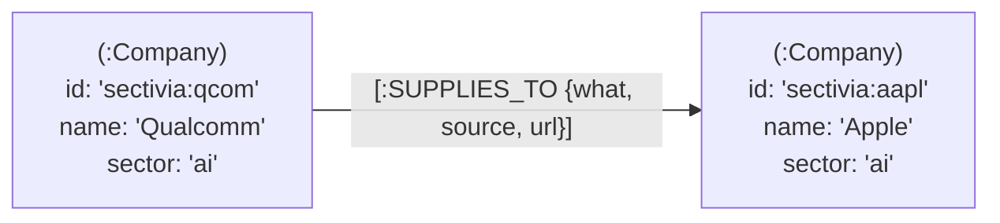

# AtmoGraph Neo4j Database Schema Specification

## 1. Overview & Architecture

AtmoGraph utilizes Neo4j (v5.x+) as its core property graph database to represent corporate supply chain relationships and model systemic disruption propagation. The graph foundation represents upstream component, energy, and material suppliers flowing downstream into tier-1 manufacturers, integrators, and service providers.



### Key Architectural Principles
1. **General Labeling**: All organizational entities share the primary label `:Company`.
2. **Deterministic Namespacing**: Primary keys use source-prefixed identifiers (e.g., `sectivia:aapl`) to prevent collisions when integrating other datasets in the future.
3. **Directional Semantics**: Edges always point from upstream supplier to downstream buyer:
   $$\text{Supplier} \xrightarrow{\text{SUPPLIES\_TO}} \text{Customer}$$
   Disruptions ripple in the direction of the edge (downstream product shortages) or against it (upstream demand shock).
4. **Strict Ground-Truth Integrity**: The dataset contains real-world commercial relationships verified from SEC filings (10-K, 8-K) and official corporate supplier disclosures. It contains **no real-world disruption ground truth**; disruption attributes are strictly simulated.

---

## 2. Node Schema: `:Company`

| Property | Cypher Type | Nullable | Example | Description |
| :--- | :--- | :--- | :--- | :--- |
| `id` | `STRING` | **NO** (Primary Key) | `"sectivia:aapl"` | Unique namespaced identifier (`<source>:<raw_id>`). |
| `raw_id` | `STRING` | **NO** | `"aapl"` | Source-specific identifier from raw dataset. |
| `ticker` | `STRING` | YES | `"AAPL"` | Public stock ticker symbol. `null` for private companies (e.g., SpaceX). |
| `name` | `STRING` | **NO** | `"Apple"` | Full legal / corporate commercial name. |
| `exchange` | `STRING` | YES | `"NASDAQ"` | Primary listing exchange (`NASDAQ`, `NYSE`). `null` for private firms. |
| `country` | `STRING` | **NO** | `"USA"` | Headquarters country (e.g. `USA`, `Ireland`). |
| `sector` | `STRING` | **NO** | `"ai"` | Sectivia primary sector category code. |
| `sector_name` | `STRING` | **NO** | `"AI & digital infrastructure"` | Normalized human-readable English sector name. |
| `segment` | `STRING` | **NO** | `"Devices & electronics manufacturing"` | Granular sub-industry segment. |
| `listed` | `BOOLEAN` | **NO** | `true` | Public listing status (`true` for public, `false` for private). |
| `relations_count` | `INTEGER` | **NO** | `14` | Total supplier/customer connections reported in Sectivia baseline. |
| `data_source` | `STRING` | **NO** | `"sectivia"` | Ingestion provenance tag. |
| `updated_at` | `DATETIME` | **NO** | `2026-11-21T23:45:00Z` | Ingestion / update timestamp. |

---

## 3. Relationship Schema: `[:SUPPLIES_TO]`

Directed edge: `(:Company)-[:SUPPLIES_TO]->(:Company)`

| Property | Cypher Type | Nullable | Example | Description |
| :--- | :--- | :--- | :--- | :--- |
| `what` | `STRING` | **NO** | `"Chips for Apple products, on Apple's official supplier list"` | Commercial description of goods, inputs, or services supplied. |
| `source` | `STRING` | **NO** | `"Apple Supplier List (fiscal 2023), April 2024"` | Evidence citation (e.g. SEC 10-K, 8-K, Press Release). |
| `url` | `STRING` | **NO** | `"https://www.sec.gov/Archives/edgar/data/..."` | Verifiable audit URL (SEC EDGAR archive or corporate press release). |
| `sector` | `STRING` | YES | `"ai"` | Sector code if both companies belong to the same sector; `null` if cross-sector. |
| `supplier_sector` | `STRING` | **NO** | `"ai"` | Upstream supplier sector code. |
| `customer_sector` | `STRING` | **NO** | `"ai"` | Downstream customer sector code. |
| `supplier_segment` | `STRING` | **NO** | `"Chips & accelerators"` | Upstream supplier sub-segment. |
| `customer_segment` | `STRING` | **NO** | `"Devices & electronics manufacturing"` | Downstream customer sub-segment. |
| `is_cross_sector` | `BOOLEAN` | **NO** | `false` | Flag indicating inter-industry dependency (`supplier_sector != customer_sector`). |
| `data_source` | `STRING` | **NO** | `"sectivia"` | Ingestion provenance tag. |
| `updated_at` | `DATETIME` | **NO** | `2026-11-21T23:45:00Z` | Timestamp when edge was loaded. |

---

## 4. Constraints & Performance Indexes

Constraints and indexes defined in [constraints.cypher](file:///d:/AtmoGraph/database/constraints.cypher):

```cypher
// Uniqueness Constraint (Primary Key)
CREATE CONSTRAINT constraint_company_unique_id IF NOT EXISTS
FOR (c:Company) REQUIRE c.id IS UNIQUE;

// Node Lookup Indexes
CREATE INDEX index_company_ticker IF NOT EXISTS FOR (c:Company) ON (c.ticker);
CREATE INDEX index_company_name IF NOT EXISTS FOR (c:Company) ON (c.name);
CREATE INDEX index_company_raw_id IF NOT EXISTS FOR (c:Company) ON (c.raw_id);
CREATE INDEX index_company_sector IF NOT EXISTS FOR (c:Company) ON (c.sector);
CREATE INDEX index_company_segment IF NOT EXISTS FOR (c:Company) ON (c.segment);
CREATE INDEX index_company_country IF NOT EXISTS FOR (c:Company) ON (c.country);
CREATE INDEX index_company_listed IF NOT EXISTS FOR (c:Company) ON (c.listed);

// Relationship Indexes
CREATE INDEX index_supplies_to_cross_sector IF NOT EXISTS FOR ()-[r:SUPPLIES_TO]-() ON (r.is_cross_sector);
CREATE INDEX index_supplies_to_datasource IF NOT EXISTS FOR ()-[r:SUPPLIES_TO]-() ON (r.data_source);
```

---

## 5. Idempotent Ingestion Pattern

All loading routines (`import_sectivia.cypher` and `scripts/import_data.py`) use Cypher `MERGE` statements parameterized by stable identifiers:

```cypher
// Idempotent node creation
MERGE (c:Company { id: 'sectivia:' + row.id })
SET c.name = row.name, ...;

// Idempotent edge creation
MATCH (s:Company { id: 'sectivia:' + row.supplier_id })
MATCH (c:Company { id: 'sectivia:' + row.customer_id })
MERGE (s)-[r:SUPPLIES_TO { what: row.what, source: row.source }]->(c)
SET r.url = row.url, ...;
```

This ensures that re-running the import script is completely safe, creates no duplicate nodes or edges, and updates existing records in place.
